<p align="center">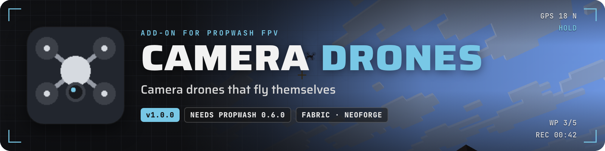</p>

Version **1.0.0** · Author: lardtom · License: see [License](#license).

**Camera drones that fly themselves, for Propwash FPV.** Let go of the sticks and the drone stops in the air. It holds
its position by GPS, carries a stabilized 3-axis gimbal camera and flies missions you plan on a tablet: waypoints,
follow me, point of interest and course lock. A second player can steer the camera with their own radio.

<p align="center">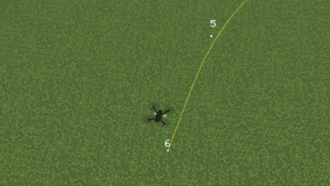</p>

<p align="center"><a href="https://modrinth.com/mod/propwash-fpv">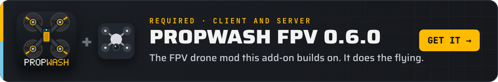</a></p>

<p align="center">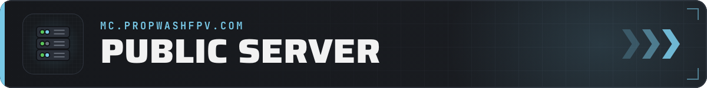</p>

<p align="center"></p>

Play Propwash with others on our public server **`mc.propwashfpv.com`**. Since Propwash 0.6.0 you can join with
**Fabric or NeoForge**. Add the address to your server list; if the server needs a mod you don't have, the join screen
names it.

<p align="center">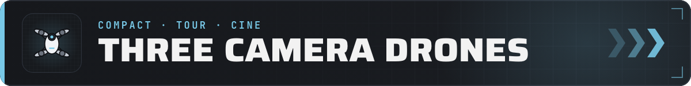</p>

FPV quads are fast and wild. Camera drones are the calm ones:

| | FPV quad | Camera drone |
|---|---|---|
| Sticks | rotation rates | speed: let go and it brakes and holds |
| Camera | fixed, shakes with the frame | 3-axis gimbal, level horizon |
| Flight time | 3 to 6 min | about 26 to 41 min |
| Programmable | no | waypoints, hold, follow me, point of interest, course lock |

- **Compact, Tour and Cine.** 244 g and about 30 min hover, 720 g and about 41 min with wide and tele camera, or 3.8 kg and about 26 min with a 360° gimbal and interchangeable 24, 50 and 85 mm lenses. Ready to fly in their own creative tab.
- **19 parts with real-world values.** Folding frames, nav flight controllers with GPS, compass and barometer, low-KV motors, folding props, smart batteries, digital camera links and gimbals. Every part has a survival recipe; build at Propwash's workbench.

The physics stays Propwash's own flight model, with wind, gusts, prop wash and the battery curve. The add-on brings the
parts and the flight assist on top.

<p align="center">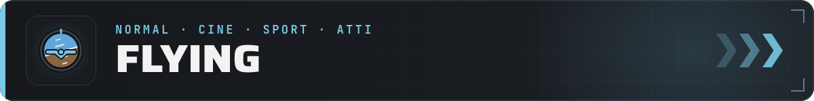</p>

- **Normal, Cine and Sport.** On a three-position switch: speed control with braking, smoothed sticks for calm shots, or manual flight for speed.
- **ATTI without GPS.** Under blocks, in caves or with a disturbed compass the drone holds its height and drifts with the wind.
- **Obstacle sensors.** The Pro flight controller stops in front of walls, with a parking-sensor beep. Altitude limit, OSD elements and warnings sit in Propwash's OSD editor.

<p align="center">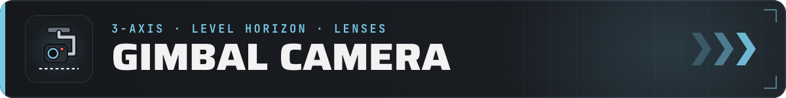</p>

- **Two cameras.** The FPV camera is for the pilot, the stabilized gimbal for the shot; one key switches your view. The horizon stays level while the drone rolls, tilt goes down to −90°, and the gimbal picture never shows the props.
- **Direct or Flashback recording.** Save the gimbal picture as a video or photo, or record its camera path into Flashback (Fabric), even in the background while a mission flies.

<p align="center">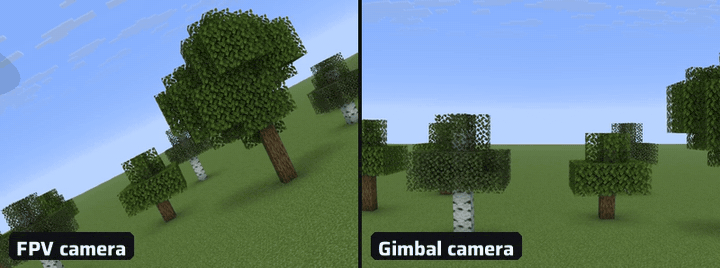</p>

<p align="center">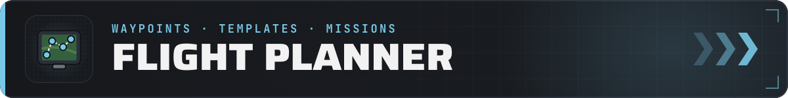</p>

Click blocks to drop waypoints into the world, set them in flight or record a flight. The editor shows a top-down map
and a list of waypoints with height, speed, wait time, gimbal tilt, look direction and photo or recording actions,
templates for a circle, a reveal and a line, and a preview of length, time and battery use.

<p align="center">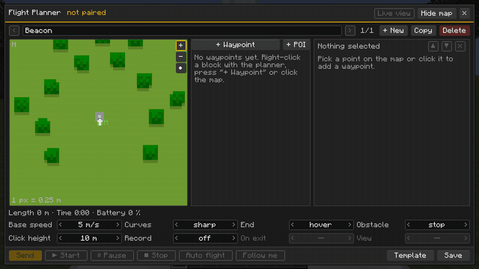</p>

- **Send and start.** The drone takes off by itself, flies the mission and keeps flying when you take off the goggles. Put them back on and you take over.
- **Landing pad.** Put it where the drone should land. A camera drone flying without a pilot centres itself above the pad and touches down in its middle.
- **FPV drones too.** The planner also flies freestyle, race and long-range drones (Just More Parts frames included) on the GPS of their flight controller, as long as nobody is wearing the goggles.

<p align="center">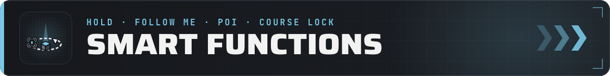</p>

- **Hold.** An air tripod for minutes at a time.
- **Follow me.** Behind you, beside you or just watching.
- **Point of interest.** Circle whatever is in the middle of the picture; the sticks change radius and speed.
- **Course lock.** Fly straight while the camera turns.

<p align="center">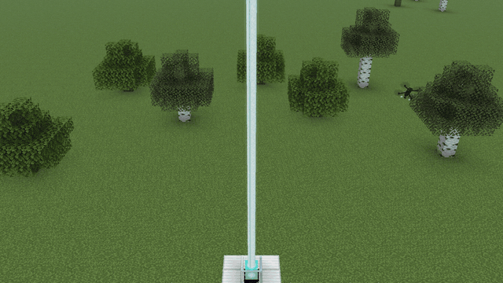</p>

<p align="center">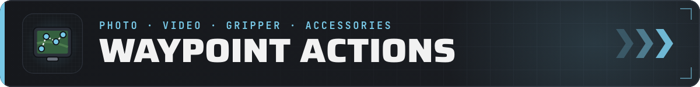</p>

Every waypoint can take a photo or start and stop a recording when the drone gets there. On top of that, a waypoint
can trigger an accessory:

- **Accessory actions.** A waypoint presses an accessory action just like the keys in flight: once, from that point on, or timed every few ticks. A dispenser from another add-on fires on the planned spot, with its own cooldown and rules.
- **Pick up and drop.** With Propwash's gripper under an FPV drone, the mission picks up an item when it flies low over it, and *Release gripper* at a later waypoint drops the cargo there.
- **Photos on the way.** Photos and recordings always come from the gimbal camera, so the horizon stays level while the drone banks through the mission.

<p align="center">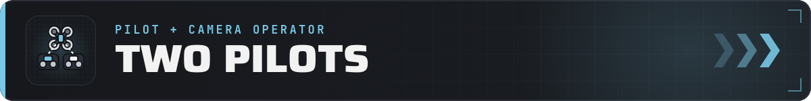</p>

- **Pilot and camera operator.** Invite a player as camera operator: they pan, tilt, zoom, record and take photos with their own radio while you fly.
- **Camera on your own.** Start a mission alone and the *Live view* in the Flight Planner lets you pan and tilt the gimbal like a camera operator while the drone flies itself.

<p align="center">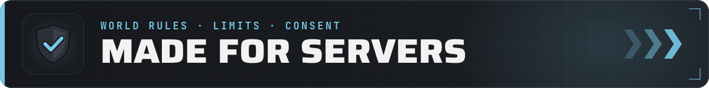</p>

- **The server decides.** It checks every mission, follow target and crew request; `/camdrones` covers missions, hold, follow me and the crew.
- **World rules.** Flights without pilot, following other players (off by default and always with their consent), second pilot, altitude and distance limit, time limit for flights without pilot. None of them touches FPV races.
- **Fair limits.** One flight without pilot per player by default. It ends when the owner goes offline or the battery runs low.

<p align="center">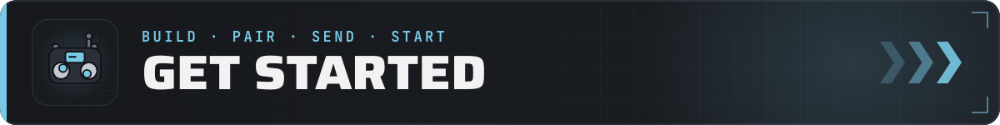</p>

1. Put Camera Drones next to **Propwash FPV 0.6.0** into the `mods` folder (Fabric or NeoForge), on the server and on
   every client.
2. Take a ready-to-fly *Compact*, *Tour* or *Cine* from the add-on's creative tab, or craft the parts and build the
   drone at Propwash's workbench.
3. Fly it like any Propwash drone. Let go of the sticks and it holds; **Delete** switches to the gimbal camera.
4. Sneak and right-click your parked drone with the **Flight Planner** to pair it. Click blocks to set waypoints, then
   press **Send** and **▶ Start**.

Four Flight School chapters show the add-on in short scenes. Hold **M** over a camera part, the Flight Planner or the
landing pad to open them.

<p align="center">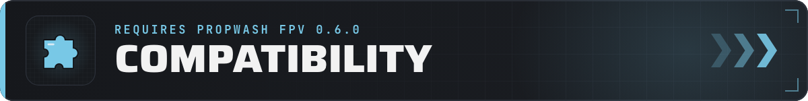</p>

- Minecraft 26.3 · Fabric (with Fabric API) or NeoForge · Java 25 · on the server **and** every client
- [Propwash FPV](https://modrinth.com/mod/propwash-fpv) **0.6.0** or newer
- Works with [Just More Parts](https://modrinth.com/mod/propwash-just-more-parts) and [Mob Defense](https://www.curseforge.com/minecraft/mc-mods/propwash-mob-defense). Camera drones go into Propwash's share codes like every other drone.
- English and German

<p align="center">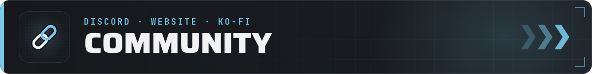</p>

<p align="center">

[](https://discord.gg/bNhkSXYSgZ) [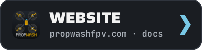](https://propwashfpv.com) [](https://ko-fi.com/propwashfpv)

</p>

Questions, flight plans, cinematic shots? Join the Discord or read the docs on the website. Propwash and its add-ons
are free; if you enjoy them, you can support the project on [Ko-fi](https://ko-fi.com/propwashfpv). Thank you!

## Documentation

- Player guide: [`docs/guide.md`](docs/guide.md) (English), [`docs/guide.de.md`](docs/guide.de.md) (German)
- Changes for players: [`CHANGELOG.md`](CHANGELOG.md)
- Tests: [`docs/testing.md`](docs/testing.md), share-code table: [`docs/sharecode.md`](docs/sharecode.md), release:
  [`docs/RELEASING.md`](docs/RELEASING.md) (German)
- Design: [`docs/design.md`](docs/design.md), conventions: [`docs/CONVENTIONS.md`](docs/CONVENTIONS.md) (German)

## Build

```
./gradlew build
```

Propwash must be published to the local Maven repository first (in the Propwash repository:
`./gradlew publishToMavenLocal`); the version is `propwash_version` in `gradle.properties`. `build` also checks the
share-code table with Propwash's `ShareTableCheck`. The web export for the website: `./gradlew :fabric:runWebExport`,
then `python3 tools/web_export.py`.

## License

Code under the PolyForm Shield License 1.0.0 with additional permissions ([`LICENSE`](LICENSE): modpacks are allowed,
and an exit clause makes the code MIT after 12 months without releases or maintainer activity), documentation under
MIT ([`LICENSE-MIT`](LICENSE-MIT)), see [`NOTICE`](NOTICE). The namespace `propwash` belongs to Propwash; this add-on
uses `camdrones`.

Made by lardtom. NOT AN OFFICIAL MINECRAFT PRODUCT. NOT APPROVED BY OR ASSOCIATED WITH MOJANG OR MICROSOFT.
